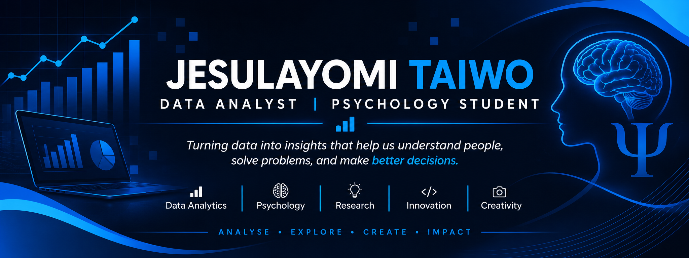

  

<h1 align="center">Hi, I'm Jesulayomi 👋</h1>

<h3 align="center">Data Analyst | Psychology Student</h3>

  Turning data into insights that help us understand people, solve problems, and make better decisions.

<h2 align="center">👩‍💻 About Me</h2>

  

- 🎓 Psychology undergraduate at the University of Ibadan.
- 📊 Interested in data analytics, research, and evidence-based decision-making.
- 🧠 Passionate about exploring the intersection of psychology, people, and data.
- 🔍 Experienced in data cleaning, analysis, and creating visual reports.
- 🌱 Continuously learning and building projects to strengthen my analytical skills.
- 🤝 Open to collaborations, learning opportunities, and data analytics opportunities.

<h2 align="center">🛠️ Technical & Creative Skills</h2>

  

### 📊 Data Analysis & Programming

  
  
  

### 📈 Data Visualisation

  
  

### 🔬 Research & Data Collection

  
  
  

### 🎨 Creative & Digital Skills

  
  
  
  

### 🤖 Productivity & AI Tools

  
  
  
  

<h2 align="center">📂 Featured Projects</h2>

  

  A selection of projects demonstrating my experience in data analysis, problem-solving, research, and data visualisation.

<table>
  <tr>
    <th>Project</th>
    <th>Focus Area</th>
    <th>Tools & Technologies</th>
  </tr>
  <tr>
    <td><b>Zion Tech Hub</b></td>
    <td>Healthcare Analytics</td>
    <td>Excel, SQL, Python, Tableau</td>
  </tr>
  <tr>
    <td><b>Codveda Internship</b></td>
    <td>Data Analysis & Visualisation</td>
    <td>Excel, Python, Power BI, Tableau</td>
  </tr>
  <tr>
    <td><b>Bloom & Thrive Wellness Co.</b></td>
    <td>Business Analytics</td>
    <td>Excel, SQL</td>
  </tr>
  <tr>
    <td><b>Healthcare Data Cleaning</b></td>
    <td>Healthcare Data Preparation</td>
    <td>Python, Pandas</td>
  </tr>
  <tr>
    <td><b>SQL Orders Project</b></td>
    <td>Sales Data Analysis</td>
    <td>SQL</td>
  </tr>
  <tr>
    <td><b>Company Sales Analysis</b></td>
    <td>Business & Sales Analytics</td>
    <td>Excel, SQL</td>
  </tr>
</table>

  

<h2 align="center">📊 GitHub Statistics</h2>

  

  
  

<h2 align="center">🤝 Let's Connect</h2>

  

  I'm always open to connecting with fellow data enthusiasts, collaborating on meaningful projects, and exploring opportunities where data can create impact.

  
 
  

  <i>Turning data into insights, and insights into impact.</i>

